 

## About me

I'm a Software Analysis and Development (ADSO) student at SENA, interested in backend development, relational databases and software architecture.

I enjoy understanding how software works, from its underlying logic to the interaction between its components.

- Currently developing **MotoRent**.
- Strengthening my knowledge of TypeScript, Python and SQL.
- Studying computer science through Harvard's CS50.
- Open to software development apprenticeship opportunities.
- Based in Bogotá, Colombia.

## Tech stack

### Backend

### Databases & ORM

### Frontend

### Development tools

### Currently learning

## Selected projects

| Project | Description | Stack |
| :--- | :--- | :--- |
| [**MotoRent**](https://github.com/haroldmerchan2025-jpg/MOTORENT-PROYECTO-)| Full-stack motorcycle rental marketplace. | TypeScript, Express, React, PostgreSQL, Prisma |
| [**MiniHelpDesk**](https://github.com/K-vothe/minihelpdesk-semgrep) | Ticket management application with static security analysis. | Node.js, Prisma, Semgrep |
| [**IncidentHub**](https://github.com/K-vothe/Incidenthub-Api2) | Backend API for incident management. | TypeScript |

## Education

| Institution | Program | Status |
| :--- | :--- | :--- |
| SENA | Software Analysis and Development | In progress |
| Harvard CS50 | Introduction to Computer Science | In progress |
| SMART English Academy | English — B1 | In progress |

## GitHub activity

---

Build. Learn. Improve.

